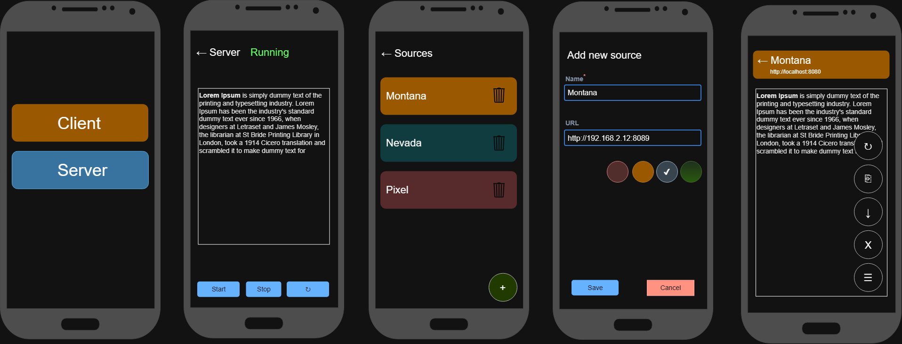

# Grabbic (WIP)

Handy clipboard sharing app



## Things to note

* Room's Flows are cold, but it does not mean it won't push updates do consumers. 
    If there is a collector(subscriber) Room will watch for DB changes in relevant tables and
    push updates (if any)
    When navigating between screens (navController), Compose won't run `init{}` method second time 
    for already initialized viewmodel, ex: navigating back to ListView from AddNewItemView. That
    means if we want to see updates after navigating back, we have two options:
    * Reactive: Use `StateFlow<>` on Screen side which can be obtained from cold `Flow<>` by using
        the `stateIn()` method (see `ClipSourceSelectionViewModel`)
    * Traditional: Make viewModel expose dedicated `reloadData()` method and call it from the screen
        from within `LifecycleResumeEffect`


* To use SVG icons from `https://fonts.google.com/` download them as XML (Android) and remove/replace 
    all android-specific attributes as they won't work in KMP app, ex:
    
    Before:
    ```xml
    <vector xmlns:android="http://schemas.android.com/apk/res/android"
        android:width="24dp"
        android:height="24dp"
        android:viewportWidth="960"
        android:viewportHeight="960"
        android:tint="?attr/colorControlNormal">
      <path
          android:fillColor="@android:color/white"
          android:pathData="M280,840Q247,840 223.5,816.5Q200,793 200,760L200,240L160,240L160,160L360,160L360,120L600,120L600,160L800,160L800,240L760,240L760,760Q760,793 736.5,816.5Q713,840 680,840L280,840ZM680,240L280,240L280,760Q280,760 280,760Q280,760 280,760L680,760Q680,760 680,760Q680,760 680,760L680,240ZM360,680L440,680L440,320L360,320L360,680ZM520,680L600,680L600,320L520,320L520,680ZM280,240L280,240L280,760Q280,760 280,760Q280,760 280,760L280,760Q280,760 280,760Q280,760 280,760L280,240Z"/>
    </vector>
    ```
    After:
    ```xml
    <vector xmlns:android="http://schemas.android.com/apk/res/android"
        android:width="24dp"
        android:height="24dp"
        android:viewportWidth="960"
        android:viewportHeight="960">
      <path
          android:fillColor="#FF000000"
          android:pathData="M280,840Q247,840 223.5,816.5Q200,793 200,760L200,240L160,240L160,160L360,160L360,120L600,120L600,160L800,160L800,240L760,240L760,760Q760,793 736.5,816.5Q713,840 680,840L280,840ZM680,240L280,240L280,760Q280,760 280,760Q280,760 280,760L680,760Q680,760 680,760Q680,760 680,760L680,240ZM360,680L440,680L440,320L360,320L360,680ZM520,680L600,680L600,320L520,320L520,680ZM280,240L280,240L280,760Q280,760 280,760Q280,760 280,760L280,760Q280,760 280,760Q280,760 280,760L280,240Z"/>
    </vector>
    ```
    
* Embedded server startup is a blocking operation, so it is better to run it on `Dispatchers.IO`.
    Take `ServerViewModel` for example, if we remove `Dispatchers.IO` from `startServer()` 
    and `stopServer()` calls then we won't be able to see intermediate statuses like `Starting`, 
    because server startup will be executing on a main thread (`viewModelScope` default). So the 
    main thread will be blocked and by the moment it is released the `Started` sated will 
    already be published to `StateFlow` and it will overwrite `Starting` state pushed earlier due 
    to **state conflation**.
